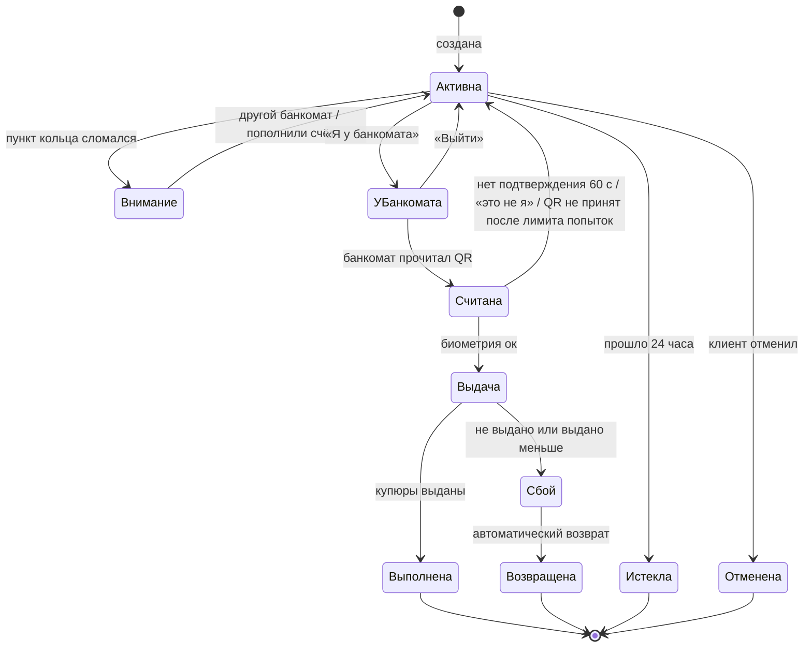
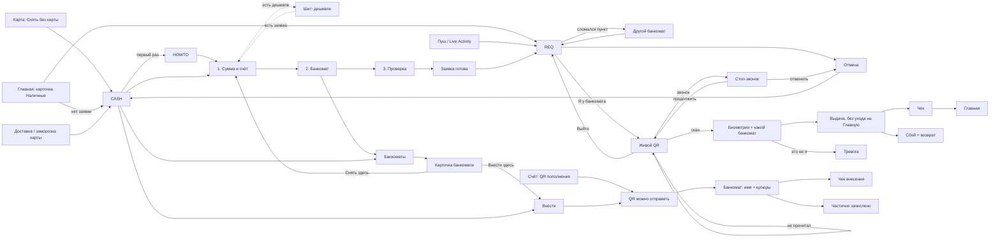

# Информационная архитектура: наличные без карты

Навигационная истина функции. Узла или перехода, которого здесь нет, не существует.
Экраны, low-fi, FigJam и сценарии мапятся отсюда.

**Связанные артефакты (2026-11-10).** План экранов и состояний — [`qr-withdraw-flow.md`](qr-withdraw-flow.md). Сценарии — [`scenarios.md`](scenarios.md). Карта на доске — [`figjam.md`](figjam.md). Старый форк Т-банка `37:4202` не является этой картой.

Коды узлов (`CASH`, `REQ`) — стабильные ключи для сценариев. Названия, действия и
копирайт в этом файле — **по-русски**. Испанские строки приложения появятся в
контент-пакете среды 3.

**Основание.** Задание, исследование и новые вводные после оценки доски:

| Источник | Что берём в ИА |
|----------|----------------|
| Задание | Вход не рядом с «Перевод» и «Пополнение»; счёт и сумма; QR 24 часа; ближайший банкомат; защита от скриншота; до / во время / после |
| Исследование Figma | Снимать **и вносить** наличные без карты |
| Четыре банка на доске `33:4201` | Банкомат сканирует телефон; карта связана со снятием; ошибок выдачи нет ни у кого — у нас они обязательны |
| Справка Т-банка | Не копировать «Сохранить / Поделиться», вход через Платежи, 30 минут, код из пуша в банкомат |
| Схема Plata `37:4202` | Комиссия до создания; QR умеет обновляться без сети; инструкция; возврат к заявке; банкомат показывает сумму с комиссией. Три модели подтверждения, 5 минут QR и пополнение как у Т-банка — **не берём** |

## Что изменилось 8 ноября

- Документ переведён на русский: узлы, действия, граф.
- Зафиксировано **одно** подтверждение у банкомата: скан → биометрия на телефоне с суммой и адресом. Код в банкомат из пуша и отдельный «код в приложении» запрещены.
- Заявка живёт **24 часа**. QR живёт **30 секунд** и существует только в режиме «Я у банкомата». Вариант «QR 5 минут в кармане» отвергнут.
- Добавлено **внесение наличных по QR** в тот же хаб «Наличные», визуально другим QR.
- Добавлены ветки: банкомат не прочитал QR; клиент уходит во время выдачи; на счёте не хватило после создания заявки.
- Закрыт вопрос направления скана: банкомат читает телефон.

## Ключевые решения

| Решение | Почему |
|---------|--------|
| **Снятие = заявка на 24 часа + живой QR.** Заявка (счёт, сумма, срок) создаётся дома. QR — ключ к заявке. Он появляется только в режиме «Я у банкомата» и меняет узор каждые 30 секунд | Задание требует «QR действует 24 часа» — столько живёт *право* снять. Украденный снимок через 30 секунд бесполезен |
| **Банкомат сканирует телефон**, не наоборот | Как у Т-банка: QR подносится туда же, куда карта. Нельзя наклеить чужой QR на экран банкомата. Камера не нужна |
| **Одно подтверждение — биометрия на телефоне после скана.** На экране: сумма, комиссия в песо, какой банкомат связался | Даже если QR увидели, без телефона владельца денег не выдадут. Код в банкомат и код из пуша убирают внимание и ломаются без сети |
| **Деньги не блокируются при создании заявки.** Баланс проверяется в кольце готовности и в момент подтверждения | Деньги свободны до момента выдачи. Если остаток упал — кольцо краснеет до поездки |
| **Банкомат в заявке — план, не привязка.** Снять можно в любом банкомате Plata | Сломался выбранный — заявка жива, меняется только пункт |
| **Одна активная заявка** | Проще модель, меньше мошенничества. Сменить сумму = отменить и создать заново |
| **Два разных QR.** Снятие: нельзя делиться, живой, только у банкомата. Внесение: можно отправить, статичный, другой цвет и подпись | На схеме Т-банка и на нашей копии `37:4202` они выглядят одинаково — мошенник просит «QR для пополнения» |
| **Название раздела — «Наличные», действие снятия — «Снять без карты»** | В приложении «Withdraw» уже занято переводом с кредита. Вкладка «Платежи» для снятия запрещена заданием |

## 1. Модель навигации

| Слой | Роль | Вход | Выход | Таббар |
|------|------|------|-------|--------|
| Корень | Вкладки: Главная · Платежи · Инвестиции · Рефералка + чат | Таббар | Переключение вкладки | Виден |
| Пуш | Просмотр сущности: хаб «Наличные», заявка, банкомат, чек | Тап по сущности | «Назад», ровно один шаг | Виден |
| Модальный поток | Создание заявки, 3 шага | «Снять без карты» | «Назад» — прошлый шаг; крестик — закрыть, с вопросом, если что-то введено | Скрыт |
| Шит | Короткий выбор: дешёвый путь, отмена, другой банкомат, подтверждение суммы | Действие на экране | Свайп вниз, тап мимо, кнопка | Скрыт |
| Режим «у банкомата» | Полноэкранный тёмный режим с QR, защита от записи экрана | «Я у банкомата» | Только «Выйти». Системный жест «назад» = «Выйти», QR гаснет сразу | Скрыт |
| Оверлей | Заявка создана; стоп при звонке; банкомат считает купюры | Событие | Явное действие. Во время выдачи «на главную» нет | Скрыт |
| Вне приложения | Пуши, Live Activity, виджет | Событие системы | Тап → узел внутри | — |

**Правила**
- Пуш из пуша можно: хаб → заявка → банкомат.
- Модальный поток и режим «у банкомата» не открывают друг друга. После создания заявки всегда сначала экран заявки, потом QR.
- Пока банкомат считает купюры, приложение не предлагает закрыться или уйти на Главную.

## 2. Место функции в приложении

Новое помечено `+`. Существующее — по аудиту SCRN.

```
Главная
├── + Карточка «Наличные» в сетке виджетов (W-CASH) ──────────┐
├── Кредит / Счёт
│   └── Карта
│       ├── Заморозить · Перевыпустить · Закрыть
│       ├── + Снять без карты ────────────────────────────────┤
│       └── Безопасность → Снятия в банкомате                 │
├── Операции → + детали снятия или внесения (TX)              │
└── Профиль → Защита «Escudo de Plata»                        │
    └── + Снятие без карты: настройки (ESC-CASH)              │
                                                              ▼
                                    + Наличные (CASH, хаб)
                                    ├── Активная заявка (REQ)
                                    │   └── Я у банкомата (ATM-MODE)
                                    │       └── Чек (DONE) / Сбой (FAIL)
                                    ├── Снять без карты (NEW-AMT → NEW-ATM → NEW-SUM)
                                    ├── Внести наличные (DEP)
                                    │   └── QR пополнения (DEP-QR) → у банкомата (DEP-ATM)
                                    │       └── Чек внесения (DEP-DONE) / частичный (DEP-PART)
                                    ├── Банкоматы Plata (MAP)
                                    │   └── Карточка банкомата (ATM-DET)
                                    ├── Как это работает (HOWTO)
                                    └── История (TX)

Платежи ── Внести · Переводы · Избранное · Платежи
           ↑ снятия здесь НЕТ
           ↑ внесение наличными в банкомате здесь НЕТ
             (обычное пополнение счёта с карты / перевода — как сейчас)
```

## 3. Точки входа

### Снятие

| ID | Где | Что видит клиент | Условие | Куда | Приоритет |
|----|-----|------------------|---------|------|-----------|
| E1 | Экран карты, ряд «Заморозить / Перевыпустить / Закрыть» | «Снять без карты» | Всегда | CASH | **M** |
| E2 | Главная, сетка карточек | «Наличные · банкомат в 12 мин» или активная заявка с кольцом | Если карточку не убрали | Нет заявки → CASH; есть → REQ | **M** |
| E3 | Доставка карты | «Карта ещё едет — снять наличные уже можно» | Карта не получена | CASH | S |
| E4 | Замороженная или перевыпускаемая карта | «Без карты тоже можно снять» | Карта заморожена или перевыпускается | CASH | S |
| E5 | Live Activity / пуш | Шаг заявки или смена статуса | Есть активная заявка | REQ | **M** |
| E6 | Escudo de Plata | Строка «Снятие без карты» | Всегда | ESC-CASH | S |
| E7 | Виджет на рабочем столе | «Ближайший банкомат» | Позже | CASH | C |

### Внесение

| ID | Где | Что видит клиент | Условие | Куда | Приоритет |
|----|-----|------------------|---------|------|-----------|
| D1 | Хаб «Наличные» | «Внести наличные» | Всегда | DEP | **M** |
| D2 | Экран счёта, блок QR | QR пополнения, подпись «можно отправить» | Всегда | DEP-QR | **M** |
| D3 | Карточка банкомата | «Внести здесь» | Банкомат принимает внесение | DEP с этим банкоматом | S |

**Запрещено**
- вкладка «Платежи» для снятия и для внесения наличными в банкомате;
- ряд быстрых действий счёта «Внести / Оплатить / Перевести» — снятие туда не ставить;
- соседство с «Withdraw» кредита;
- кнопка «QR» на Главной, если это сканер оплаты: это вход Т-банка и Райффайзена, не наш;
- «Сохранить изображение» и «Поделиться» у QR снятия.

## 4. Узлы

### Снятие

| ID | Что это | Зачем | Когда | Куда ведёт каждый интерактив |
|----|---------|-------|-------|------------------------------|
| **W-CASH** | Карточка «Наличные» на Главной | Вход и статус без лишних тапов | Всегда | Тап → REQ [есть заявка] / CASH [нет] |
| **CASH** | Хаб «Наличные» | Одно место для наличных без карты | Из E1–E4, E7, D1 | «Снять без карты» → HOWTO [первый раз] / NEW-AMT [дальше] · карточка заявки → REQ [есть заявка; создание скрыто] · «Внести наличные» → DEP · ближайший банкомат → ATM-DET · «Все банкоматы» → MAP · «Как это работает» → HOWTO · «История» → список TX |
| **HOWTO** | Репетиция: схема банкомата, 3 шага | Снять страх первого раза | Автоматически перед первой заявкой; потом по ссылке | «Понятно» → NEW-AMT [из создания] / назад [из ссылки] · «Пропустить» → то же. Из репетиции всегда есть возврат, это не тупик |
| **NEW-AMT** | Шаг 1 из 3: сумма и счёт | Сколько и откуда, цена в песо | Из CASH, ATM-DET | Клавиатура, кратность $100 · чипы $500 / $1 000 / $2 000 · счета: Счёт «без комиссии», Кредит «+$116», Накопления → цена обновляется · Кредит при живых деньгах на Счёте → SH-CHEAP · «Дальше» → NEW-ATM · крестик → закрыть [пусто] / SH-DISCARD [введено] |
| **SH-CHEAP** | Шит «Так дешевле» | Не дать переплатить по незнанию | Выбран кредит, на Счёте или Накоплениях хватает | «Снять со счёта · $0» → NEW-AMT со Счётом · «Всё равно с кредита» → закрыть шит |
| **NEW-ATM** | Шаг 2 из 3: где снять | Ответ, а не голая карта | После NEW-AMT | Карточка-ответ: избранный → по пути → ближайший, где хватит купюр на сумму · «Другой банкомат» → MAP [выбор] · «Дальше» → NEW-SUM · «Назад» → NEW-AMT |
| **NEW-SUM** | Шаг 3 из 3: проверка | Итог до решения: получите / комиссия / НДС / итого, банкомат, «действует до завтра» | После NEW-ATM | Строка суммы → NEW-AMT · строка банкомата → NEW-ATM · Счёт: «Создать заявку» + биометрия → OV-CREATED · Кредит: кнопка «Снять $1 000 за $1 116» + биометрия → OV-CREATED · ошибка лимита или баланса → текст с решением на этом же шаге |
| **OV-CREATED** | Оверлей «Заявка готова» | Момент, запуск Live Activity | Заявка создана | «К заявке» → REQ (модальный поток закрыт, в стеке CASH → REQ) |
| **REQ** | Экран заявки, **одна сущность** | Быть готовым до выхода из дома | Есть активная заявка | Кольцо из 5 пунктов: открыт · работает · хватит купюр · баланс · срок. Проблема → SH-REDIRECT / NEW-AMT [баланс упал] · «Как доехать» → внешние карты · карточка банкомата → ATM-DET · «Сменить банкомат» → MAP [выбор] · «Я у банкомата» → ATM-MODE · «Отменить заявку» → SH-CANCEL · «Как это работает» → HOWTO. QR на этом экране **нет** |
| **SH-REDIRECT** | Шит «Банкомат недоступен» | Без напрасной поездки | Пункт кольца сломался | «Ехать на Vía 515 · 9 мин» → REQ с новым банкоматом · «Другие» → MAP · «Оставить» → закрыть |
| **SH-CANCEL** | Шит «Отменить заявку?» | Явная отмена с понятным итогом | Из REQ, OV-CALL, ATM-MODE | «Отменить» → CASH, заявка «отменена», Live Activity гаснет, **деньги не списывались** · «Вернуться» → закрыть |
| **MAP** | Карта и список банкоматов Plata | Обзор сети и ручной выбор | Из CASH, NEW-ATM, REQ, FAIL | Фильтры: открыт сейчас, круглосуточно, хватит на сумму, принимает QR · пин → ATM-DET · в режиме выбора «Выбрать» → возврат в вызвавший узел. Отказ в геолокации → список по районам + «Включить геолокацию». Карта **не заканчивается** карточкой без действия |
| **ATM-DET** | Карточка банкомата | Найти его с первого взгляда | Из MAP, CASH, REQ, NEW-ATM | Фото, этаж, ориентир, часы, статус, «последнее снятие 4 мин назад» · «Как доехать» → карты · «Мой банкомат» → избранное · «Снять здесь» → NEW-AMT [нет заявки] / REQ со сменой банкомата [есть] · «Внести здесь» → DEP |
| **ATM-MODE** | Режим «Я у банкомата» | Снять за ≤ 30 секунд и безопасно | Из REQ, Live Activity шаг 2 | Подсостояния — §5. «Выйти» → REQ, QR гаснет. Во время выдачи «Выйти» недоступен |
| **OV-CALL** | Оверлей «Стоп-звонок» | Сломать вишинг в момент QR | Звонок при входе в ATM-MODE или пока виден QR | «Повесил, продолжить» → ATM-MODE [если звонок ещё идёт — кнопка через 10 с] · «Отменить заявку» → SH-CANCEL · «Связаться с Plata» → чат |
| **SH-CONFIRM** | Шит после скана | Деньги выдаёт только владелец | Банкомат прочитал QR | Сумма, комиссия в песо, счёт, **название и адрес банкомата** · биометрия → ATM-MODE «Выдача» · «Это не я» → отмена на банкомате + ESC-ALERT · нет подтверждения 60 с → заявка снова активна, «можно повторить» |
| **DONE** | Чек = детали операции | Чек правды: обещали и списали | Банкомат подтвердил выдачу | «Готово» → Главная · «Сообщить о проблеме» → FAIL / чат. Если выдано меньше — сумма в чеке и автовозврат разницы |
| **FAIL** | Сбой выдачи + трекер возврата | Клиенту не нужно ничего доказывать | Сбой банкомата, не забрал купюры, «сообщить о проблеме» | Этапы «Нашли → Возвращаем → Вернули» · «Снять в другом» → MAP · «Написать в Plata» → чат |
| **ESC-ALERT** | Escudo «Снятие заблокировано» | Реакция на «это не я» | Из SH-CONFIRM | «Запретить снятие без карты» → ESC-CASH · «Написать в Plata» → чат |
| **TX** | Детали в истории | Та же сущность, что DONE или DEP-DONE | История, пуш | Как чек |
| **ESC-CASH** | Настройки снятия без карты | Вкл/выкл, дневной лимит, защита при звонке, доверенный контакт | E6, ESC-ALERT | Переключатели без перехода |

### Внесение

| ID | Что это | Зачем | Когда | Куда ведёт каждый интерактив |
|----|---------|-------|-------|------------------------------|
| **DEP** | Старт внесения | Отделить от снятия | D1, ATM-DET | «Себе на счёт» → DEP-QR · «Показать QR, чтобы мне внесли» → DEP-QR [режим «можно отправить»] · «Как это работает» → HOWTO-внесение · «Отмена» → CASH |
| **DEP-QR** | QR пополнения | Можно делиться: другой цвет, подпись «этот код только зачисляет, снять по нему нельзя» | Из DEP, D2 | «Отправить» → системный шаринг (это **не** QR снятия) · «Я у банкомата» → DEP-ATM · «Отменить этот QR» → CASH. Срок и лимит внесения видны до банкомата |
| **DEP-ATM** | У банкомата, внесение | Банкомат знает, кому кладут | Из DEP-QR, с экрана банкомата «По QR» | Банкомат считает QR с телефона · на экране банкомата **имя получателя** · биометрия владельца, если вносит сам [без СМС] · «Класть купюры» · лимит и принимаемые номиналы **до** внесения |
| **DEP-DONE** | Чек внесения | Сколько зачислено | Купюры приняты | «Готово» → Главная · пуш с суммой |
| **DEP-PART** | Частичный успех | Не тупик «не считались» | Часть купюр вернулась или превышен лимит | «Зачислено $4 000, одна купюра возвращена» · «Положить ещё» → DEP-ATM · «Готово» → DEP-DONE |

Внесение **по карте / по телефону / по договору** в этой функции не существует — это чужой банкомат Т-банка, на схему Plata не переносится.

### Пуши

Нейтральные: без суммы и без кода на заблокированном экране.

| Пуш | Когда | Куда |
|-----|-------|------|
| «Заявка на снятие готова» | Создана, клиент уже вышел | REQ |
| «Банкомат сменил статус» | Сломался пункт кольца | REQ + SH-REDIRECT |
| «Заявка истекает через 2 часа» | За 2 часа до конца срока или до закрытия банкомата | REQ |
| «Снятие выполнено» | Выдача прошла | TX |
| «Возврат идёт / завершён» | Сбой выдачи | FAIL |
| «На счёт зачислено» | Внесение прошло | TX |
| Кода снятия в пуше **нет**. SMS о снятии Plata не шлёт |

**Live Activity:** «1/3 Доехать до Chedraui Polanco» → «2/3 На банкомате: снятие по QR» → «3/3 Подтвердить на телефоне». Тап → REQ. QR в Live Activity и виджете не показывается.

## 5. Состояния

### Заявка на снятие



Денег на счёте заявка не держит. Списание — в момент перехода «Выдача». Если между «Активна» и сканом остаток упал — кольцо на REQ краснеет, скан не начинается, пока клиент не сменит счёт или сумму.

### Режим «Я у банкомата»

| Подсостояние | Что на экране | Переход |
|--------------|---------------|---------|
| Проверка | Щит на 0,5 с: звонок, запись экрана, сеть | Звонок → OV-CALL · запись → «Останови запись» · всё ок → Подсказка |
| Подсказка | «На банкомате нажми **Снятие по QR**» — силуэт экрана | Сама → QR, или «Уже нажал» |
| Живой QR | Тёмный экран, рамка по форме сканера, узор каждые 30 с, яркость максимум | Скан → SH-CONFIRM · скриншот → QR сразу новый + «этот код уже не работает» · 10 с без скана → «сними чехол, поднеси на 10 см» · 30 с → запасной код на 8 цифр на экране банкомата, ввод в телефон · 3 мин без действия → «ты ещё у банкомата?» · N неудачных сканов → «банкомат не принял код», повтор, затем блок на 15 мин |
| Подтверждение | SH-CONFIRM: сумма, комиссия, **какой банкомат** | Биометрия → Выдача · «это не я» → ESC-ALERT |
| Выдача | «Забери деньги» синхронно с банкоматом. Кнопок «на главную» и «закрыть» нет | Подтверждение банкомата → DONE · сбой или не забрал → FAIL · если свернуть приложение — пуш в FAIL/DONE, не молчание |
| Нет сети | Биометрия **до** показа QR. QR строится на телефоне из ключа заявки | Скан без сети · чек догрузится, когда сеть появится |

### QR пополнения

| Состояние | Смысл | Что видит клиент |
|-----------|-------|------------------|
| Можно делиться | Статичный, для зачисления | Другой цвет, «снять по этому коду нельзя» |
| Считан банкоматом | Банкомат знает получателя | Имя на экране банкомата |
| Идёт приём | Клиент кладёт купюры | Лимит и номиналы заранее |
| Зачислено / частично | Итог | Чек или DEP-PART |
| Отозван | Клиент отменил QR | «Код больше не принимает деньги» |

## 6. Граф



## 7. Инварианты

1. **Снятия нет рядом с «Перевод» и «Пополнение».** Ни во вкладке «Платежи», ни в ряду быстрых действий счёта. Сканер оплаты на Главной — не вход в снятие.
2. **Одна заявка — один экран.** Карточка на Главной, пуш, Live Activity, хаб ведут в один REQ. Пока заявка жива, создание новой ниоткуда не открывается.
3. **QR снятия существует только в режиме «Я у банкомата».** Его нет на заявке, в пушах, Live Activity, виджете, истории. Нет «Поделиться», «Сохранить», «Скопировать». QR пополнения — другой объект, его можно отправлять.
4. **Цена всегда в песо** до любого подтверждения. Процент без суммы в песо не показывается. Лимиты Т-банка (1 000–600 000 ₽) на схему Plata не переносятся.
5. **Каждое «не получится» приходит с альтернативой:** другой банкомат, другой счёт, уменьшить сумму. Экран «напишите в поддержку» как единственный выход запрещён. Отмена и ошибка не бывают тупиком.
6. **Все завершения — одна сущность:** успех снятия → DONE, сбой → FAIL с автовозвратом, внесение → DEP-DONE или DEP-PART.
7. **Из любого пуша — ровно один шаг назад.** В модальном потоке «назад» = прошлый шаг. У банкомата выход один — «Выйти», QR гаснет. Во время выдачи «закрыть» и «на главную» запрещены.
8. **Уведомления нейтральные:** без суммы и кода на экране блокировки. Код снятия в пуш и в SMS не кладётся.
9. **Мёртвых интерактивов нет.** «По карте / по телефону / по договору» на схеме Plata не рисуются. Карточка банкомата всегда ведёт к «Снять здесь» или «Внести здесь».
10. **Одна модель у банкомата.** Скан телефона → биометрия на телефоне → купюры. Параллельных путей «код из пуша в банкомат», «готовый QR» и «подтвердить кодом в приложении без выдачи» нет.

## 8. Что со схемы `37:4202` не переносим

| На доске | Почему убираем |
|----------|----------------|
| QR действует 5 минут, потом обновление | Конфликт с заданием (24 часа) и с дорогой до банкомата. Вместо этого: заявка 24 часа, QR 30 секунд у банкомата |
| Три подтверждения сразу | Клиент не понимает, что делать. Остаётся одно — биометрия после скана |
| «Приходим к банкомату» без входящей стрелки | Путь дом → банкомат идёт через заявку и карту, не через сироту |
| «Готовый QR», «код из пуша в банкомат» | Наследие Т-банка |
| «Снять наличные» рядом с «Пополнить счёт» | Ломает задание |
| «Выбирает QR-код» с Главной | Путается со сканером оплаты |
| «Закрываем окно приложения» во время купюр | Клиент уходит, не узнав результата |
| Пополнение по карте / телефону / договору | Не наш продукт |
| Лимит 1 000–600 000 | Это рубли Т-банка |

## 9. Открытые вопросы

| Вопрос | Что меняет | Кому |
|--------|------------|------|
| Переключатель «снятия в банкомате» на карте отключает и снятие без карты? | Связь E1 и ESC-CASH | Продукт карт |
| Можно ли снимать с Накоплений напрямую или только через Счёт? | Стек счетов в NEW-AMT | Продукт счетов |
| Лимиты Plata: на операцию, в день, сколько заявок | Валидация NEW-AMT | Риски |
| Отдаёт ли банкомат остаток купюр почти сразу? | Пункт «хватит наличных», фильтр карты | Команда банкоматов |
| Видит ли приложение, что идёт звонок, по правилам стора? | OV-CALL или запасной вопрос «тебе звонит банк?» | Мобильная разработка |
| Нужен ли на банкомате запасной ввод 8 цифр, если QR не читается? | Подсостояние «не прочитал» | Команда банкоматов |
| Юридически ли допустим тихий «аварийный PIN» при принуждении? | Отдельный жест в ESC-CASH | Юристы и риски |
