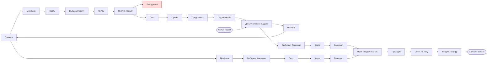
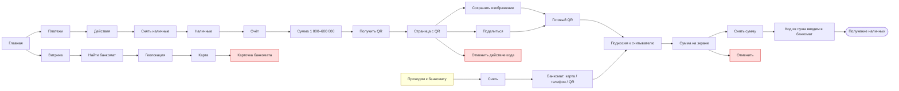
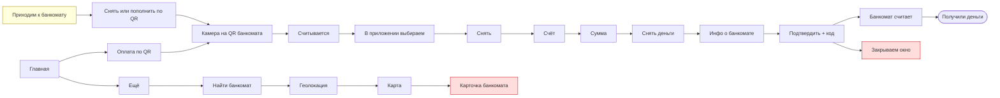
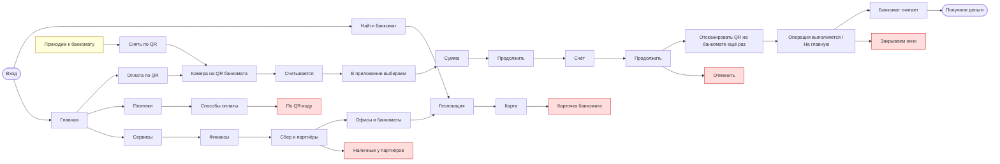
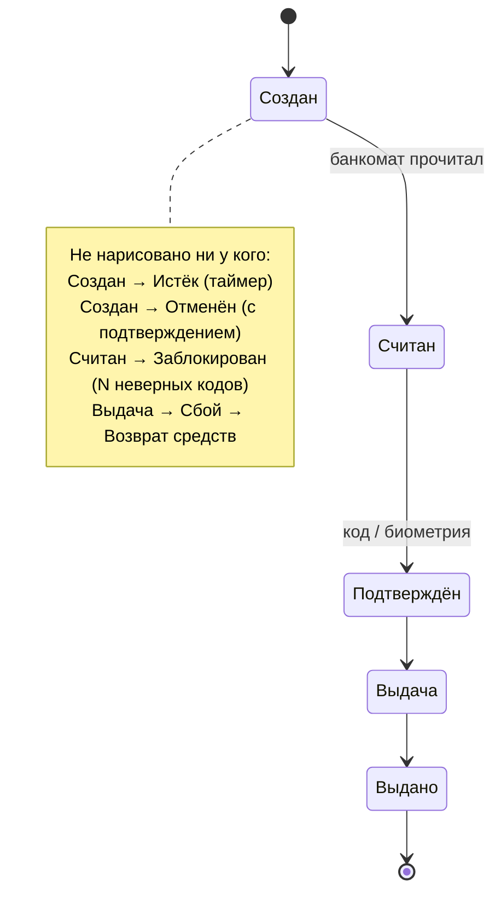

# Оценка флоу снятия наличных по QR: Alatau, Т-банк, Райффайзен, Сбер

Источник — блок-схемы на доске «Тестовое», секция `33:4201`. Оценивается схема как
нарисована: блок — шаг, стрелка — переход. **Тупик** — блок без исходящей стрелки,
который не является успехом. **Сирота** — блок без входящей стрелки, который не
является входом.

## Коротко

Все четыре схемы описывают только happy path. Ни у одного банка нет веток
«в банкомате нет денег», «нет сети», «код истёк», «деньги списались, но не
выдались». Ветки ошибок есть только у пополнения (Райффайзен, Сбер), и там они
обрываются тупиками.

Есть две модели, и они делят ответственность между «до» и «во время» по-разному:

| Модель | Банки | Где основная работа | Сколько действий у банкомата |
|--------|-------|---------------------|------------------------------|
| **Код заранее → банкомат его принимает** | Alatau (10-значный код в SMS), Т-банк (QR на телефоне + код из пуша) | дома, до выхода | 3 (Alatau) · 5 и два переключения телефон ↔ банкомат (Т-банк) |
| **Банкомат показывает QR → телефон его сканирует** | Райффайзен, Сбер | у банкомата | 8 (Райффайзен) · 10 и повторный скан (Сбер) |

Ближе всего к Plata — модель Т-банка: телефон предъявляет QR банкомату. Её минусы мы
уже закрываем: нет «Сохранить» и «Поделиться», QR живой и показывается только в
режиме у банкомата. Плюсы Alatau («до» тяжёлое, «во время» лёгкое) и Т-банка
(лимиты суммы видны сразу) стоит забрать.

| Банк | Шагов в приложении до кода | Тупиков | Сирот | Веток ошибок снятия | Чеклист планировщика, из 5 |
|------|---------------------------|---------|-------|---------------------|----------------------------|
| Alatau | 10 | 1 | 0 (+1 путь без кода) | 0 | 0 полностью, 2 частично |
| Т-банк | 8 | 6 | 1 | 0 | 0 полностью, 1 частично |
| Райффайзен | 0 (всё у банкомата) | 3 | 1 | 0 | 0 |
| Сбер | 0 (всё у банкомата) | 7 | 1 | 0 | 0 |

---

## 1. Пути по банкам (`journey-map`)

### Alatau City Bank (`33:4197`)

**Плюсы**
- «До» тяжёлое, «во время» лёгкое: у банкомата 3 действия, телефон не нужен.
- Код приходит по SMS, поэтому снятие работает без интернета у банкомата и даже без
  телефона в руке (код можно записать).
- После создания кода сразу предлагается выбрать банкомат — единственный банк, где
  поиск банкомата встроен в путь снятия.
- Есть «Инструкция» рядом с выбором способа.

**Минусы**
- Вход спрятан на 5 уровней: Главная → Мой банк → Карты → карта → Снять.
- 10 цифр вручную на клавиатуре банкомата — риск опечатки и подглядывания.
- Код передаётся по SMS: его видно на заблокированном экране, его перехватывают при
  подмене SIM, его легко продиктовать «сотруднику банка».
- Путь через Профиль ведёт в «Идёт в банкомат с кодом из СМС», хотя код на этом пути
  не создавался. Пользователь придёт к банкомату без кода.
- Через Профиль нужно выбрать город, хотя геолокацию можно запросить.
- «Инструкция» — тупик, из неё нет возврата.
- Нет отмены кода, нет срока действия, нет статуса «использован».

### Т-банк (`33:4198`)

**Плюсы**
- Модель «телефон предъявляет QR банкомату» — та же, что у Plata.
- Лимиты суммы видны на шаге ввода (от 1 000 до 600 000).
- На экране банкомата показывается сумма до выдачи — последняя проверка.
- Второй фактор: код из пуша вводится в банкомат, поэтому один украденный QR не даёт
  снять деньги.
- Пополнение по QR с той же механикой — единая ментальная модель.

**Минусы**
- Вход через Платежи → Действия: снятие наличных спрятано среди переводов (именно то,
  чего задание просит избегать).
- «Сохранить изображение» и «Поделиться» превращают QR в переносимый артефакт:
  скриншот, галерея, мессенджер. Это главная уязвимость для мошенничества.
- «Готовый QR» (на доске — опечатка «Гтовый») ведёт прямо к считывателю, минуя
  «Приходим к банкомату». Сам блок «Приходим» — сирота, путь до банкомата не
  нарисован.
- У банкомата два переключения внимания: показать QR, потом найти пуш и перепечатать
  код. Без сети пуш не придёт — снятие встанет.
- Поиск банкомата (Витрина → Карточка банкомата) не связан со снятием: из карточки
  нельзя начать снятие, а из снятия нельзя найти банкомат.
- Тупики: «Отменить действие кода», «Отменить» на банкомате, «Пополнить по карте /
  по телефону / по договору», «Карточка банкомата».

### Райффайзен (`33:4199`)

**Плюсы**
- Не нужно готовиться заранее: пришёл, отсканировал, снял.
- Вход через «Оплата по QR» на Главной — одна кнопка, привычный жест.
- «Информация о банкомате» перед подтверждением — пользователь видит, с каким
  банкоматом связался.
- Пополнение по той же механике с веткой «Отдаёт купюры обратно».

**Минусы**
- Вся работа у банкомата: 8 действий на виду у очереди и за спиной у постороннего.
- Без интернета у банкомата снятие невозможно — нет ни одного офлайн-шага.
- «Закрываем окно приложения» после подтверждения — непонятно, это отмена или
  нормальное завершение, пока банкомат считает деньги. Тупик.
- «Приходим к банкомату» — сирота: поиск банкомата заканчивается тупиком в карточке и
  к снятию не подводит.
- QR на экране банкомата — точка для подмены (наклейка поверх экрана, чужой QR).
- Ветка «Не считались» при пополнении — тупик без восстановления.

### Сбер (`33:4200`)

**Плюсы**
- Поиск банкомата доступен прямо со входа, до авторизации, — быстро найти ближайший.
- Сумма спрашивается раньше счёта: человек думает «сколько», а не «откуда».
- Отдельные ветки ошибок пополнения: «Не считались», «Превышена сумма внесения».
- Есть кнопка «Отменить» перед финальным сканом.

**Минусы**
- Двойной скан: в начале и снова после выбора счёта. Удваивает время у банкомата и
  создаёт вопрос «я уже сканировал — почему снова?».
- 10 действий у банкомата — самый длинный путь «во время» из четырёх.
- Три входа (Оплата по QR, Платежи → Способы оплаты → По QR, Сервисы → … → Офисы и
  банкоматы), из них один тупиковый — перегруженная навигация.
- «Наличные у партнёров» — тупик: обещание без продолжения.
- Семь тупиков без следующего шага: «Отменить», «Закрываем окно», «По QR-коду» в
  Платежах, «Наличные у партнёров», «Карточка банкомата», «Не считались»,
  «Превышена сумма внесения».
- «Операция выполняется / На главную» в одном блоке: пользователь может уйти на
  Главную, пока банкомат ещё считает купюры.
- Нет офлайн-режима, как у Райффайзена.

---

## 2. Аудит путей сбоя (`failure-path-audit`)

Оценка: **OK** — ветка нарисована и ведёт к следующему шагу; **PARTIAL** — ветка
есть, но обрывается; **MISSING** — ветки нет.

| # | Категория | Что должно быть во флоу снятия | Alatau | Т-банк | Райф | Сбер |
|---|-----------|--------------------------------|--------|--------|------|------|
| 1 | Пустые состояния | Нет счёта с остатком, нет банкоматов рядом, нет активного кода | MISSING | MISSING | MISSING | MISSING |
| 2 | Загрузка | Создание кода, связь с банкоматом, «банкомат считает купюры», таймаут | MISSING | MISSING | PARTIAL (есть «считает», нет таймаута) | PARTIAL (то же) |
| 3 | Валидация | Мин./макс., кратность купюрам, лимит дня, неверный код у банкомата | MISSING | PARTIAL (диапазон суммы в блоке) | MISSING | MISSING |
| 4 | Разрешения | Отказ в геолокации, отказ в камере, нет биометрии | MISSING (вместо геолокации — выбор города) | MISSING | MISSING (камера обязательна) | MISSING (камера обязательна) |
| 5 | Сеть | Телефон без сети у банкомата, банкомат офлайн | OK по устройству (SMS), MISSING как ветка | MISSING (пуш не придёт) | MISSING | MISSING |
| 6 | Незавершённость | Код создан и не использован, ушёл от банкомата посередине, свернул приложение | MISSING | MISSING | PARTIAL («Закрываем окно» — тупик) | PARTIAL (то же) |
| 7 | Отмена и восстановление | Отменить код, отменить у банкомата, вернуться на шаг, подтвердить отмену | MISSING | PARTIAL (2 отмены — тупики) | MISSING | PARTIAL («Отменить» — тупик) |
| 8 | Конфликты | Два активных кода, QR передан другому, деньги списаны, но не выданы | MISSING | MISSING (риск создан «Поделиться») | MISSING | MISSING |

| Категория | Проверено | OK | PARTIAL | MISSING | Критичный пробел |
|-----------|-----------|----|---------|---------|------------------|
| Пустые | 4 | 0 | 0 | 4 | нет «недостаточно средств» |
| Загрузка | 4 | 0 | 2 | 2 | нет таймаута выдачи |
| Валидация | 4 | 0 | 1 | 3 | неверный код у банкомата, кратность |
| Разрешения | 4 | 0 | 0 | 4 | отказ в камере у Райф/Сбер блокирует всё |
| Сеть | 4 | 0 | 0 | 4 | у трёх банков снятие встаёт без сети |
| Незавершённость | 4 | 0 | 2 | 2 | срок действия кода не показан нигде |
| Отмена | 4 | 0 | 2 | 2 | все отмены — тупики |
| Конфликты | 4 | 0 | 0 | 4 | «списали, но не выдали» — нет ни у кого |

### Пять самых вероятных сбоев, которых нет ни на одной схеме

1. **Банкомат пуст или не работает.** Пользователь пришёл, а снять нельзя. Нет ни
   статуса банкомата на карте, ни ветки «предложить ближайший рабочий».
2. **Деньги списаны, купюры не выданы.** Самая дорогая для доверия ситуация и главный
   источник жалоб в Condusef. Нет ни статуса операции, ни обещания возврата.
3. **Нет сети у банкомата** (подвал, ТЦ). У Райффайзена и Сбера снятие невозможно,
   у Т-банка не придёт пуш с кодом.
4. **Код истёк или уже использован.** Ни один банк не показывает срок действия и
   состояние кода.
5. **Неверный ввод у банкомата.** У Alatau 10 цифр вручную, у Т-банка код из пуша.
   Нет веток «неверный код», «осталась одна попытка», «код заблокирован».

### Системный паттерн

Банки рисуют ветки ошибок там, где ошибается **железо при приёме денег** («не
считались», «превышена сумма»), и не рисуют их там, где ошибается **железо при выдаче**
или **сеть**. Иначе говоря, они моделируют потерю денег банком, но не потерю денег
клиентом.

---

## 3. Модели состояний (`state-model`)

Сущность у всех — «разрешение на снятие». У Alatau и Т-банка это код, созданный
заранее; у Райффайзена и Сбера — сессия, которая открывается сканом QR банкомата.

### Что нарисовано и что подразумевается

| Состояние | Alatau | Т-банк | Райф | Сбер | Видно пользователю? |
|-----------|--------|--------|------|------|---------------------|
| Создан / готов | «Деньги готовы к выдаче» | «Страница с QR» | — | — | да |
| Скопирован наружу | — | «Сохранить», «Поделиться» | — | — | нет: копия живёт вне приложения |
| Считан банкоматом | — | «Информация о сумме» на банкомате | «Считывается код» | «Считывается код» | только на банкомате |
| Ждёт подтверждения | ввод кода | код из пуша | «Подтвердить + код» | повторный скан | частично |
| Выдача идёт | — | — | «Банкомат считает» | «Банкомат считает» | только на банкомате |
| Выдано | «Снимает деньги» | «Получение наличных» | «Получили деньги» | «Получили деньги» | нет чека в приложении |
| Отменён | — | 2 тупика | — | тупик | нет |
| **Истёк** | **не нарисован** | **не нарисован** | — (сессия) | — (сессия) | — |
| **Сбой выдачи / возврат** | **не нарисован** | **не нарисован** | **не нарисован** | **не нарисован** | — |
| **Заблокирован после попыток** | **не нарисован** | **не нарисован** | — | — | — |

### Недопустимые переходы, которые схемы не предотвращают

| Откуда | Куда | Почему нельзя | Где риск |
|--------|------|---------------|----------|
| Создан | Скопирован наружу | QR начинает жить вне контроля приложения | Т-банк: «Сохранить», «Поделиться» |
| Выдача | Главная приложения | Пользователь уходит, не узнав результата | Сбер: «Операция выполняется / На главную»; Райф, Сбер: «Закрываем окно» |
| Не создан | У банкомата с кодом | Путь без кода приводит к банкомату | Alatau: Профиль → … → «Идёт с кодом из СМС» |
| Считан | Считан повторно | Двойной скан без объяснения | Сбер |

### Связи между сущностями

- **Код ↔ счёт.** Если между созданием кода и выдачей остаток на счёте уменьшился,
  что будет с кодом? Не определено ни у кого.
- **Код ↔ банкомат.** Код Alatau и Т-банка не привязан к банкомату. Выбор банкомата у
  Alatau — справочный, на выдачу не влияет.
- **Операция ↔ списание.** Ни один банк не разделяет «списано» и «выдано». Без этого
  нельзя показать состояние «возвращаем деньги».

---

## 4. Проверка полноты (`figma-user-flow-planner`, Quality Checks)

| Проверка | Alatau | Т-банк | Райф | Сбер |
|----------|--------|--------|------|------|
| Есть все три типа состояний: загрузка, ошибка, пусто | нет | нет | нет (только «считает») | нет (только «считает») |
| Каждая развилка нарисована с обеими ветками | нет («Инструкция» без возврата) | нет (2 отмены без продолжения) | нет («Закрываем окно») | нет («Отменить», «Наличные у партнёров») |
| Входы покрывают реальные пути пользователя | частично (нет входа с Главной) | частично (поиск банкомата не ведёт к снятию) | нет («Приходим» — сирота) | нет («Приходим» — сирота) |
| Явно сказано, что вне рамок | нет | нет | нет | нет |
| Структура схемы совпадает с картой экранов | частично (путь из Профиля приводит к «коду из СМС» без кода) | нет («Готовый QR» минует «Приходим») | нет (снятие и поиск — две несвязанные схемы) | нет (то же + двойной скан) |

---

## 5. Пробелы, общие для всех четырёх

| Пробел | Есть ли в нашем сценарии Plata | Где |
|--------|-------------------------------|-----|
| Банкомат пуст / не работает | да | MAP, ATM-DET (статус банкомата), FAIL |
| Деньги списаны, но не выданы | да | FAIL → автовозврат, трекер возврата |
| Нет сети у банкомата | да | SC9: QR строится на телефоне, биометрия до показа |
| Код истёк | да | статус «Vencida», пуш за час до истечения |
| Отмена с подтверждением | да | SH-CANCEL |
| Отказ в геолокации | да | A9: список по районам + «Activar ubicación» |
| Сумма вне лимита / не кратна | да | A3: клавиатура, чип максимума |
| Код или QR вынесен наружу | да (нет Save/Share, защита от скриншота) | ATM-MODE, Escudo |
| Звонок «из банка» во время снятия | да | SC5, OV-CALL |
| Неверный ввод у банкомата, блокировка после N попыток | **проверить** | у нас скан без ручного ввода; нужна ветка «банкомат не принял QR» с повтором и ограничением попыток |
| Пользователь ушёл, пока банкомат считает купюры | **проверить** | ATM-MODE должен держать экран до DONE / FAIL и не предлагать «На главную» |
| Остаток уменьшился после создания заявки | **проверить** | нужна ветка «на счёте не хватает» при скане и предложение сменить счёт |

## 6. Что берём в Plata и чего избегаем

**Берём**
- От **Alatau**: тяжёлое «до» и лёгкое «во время». Сразу после создания заявки
  предлагать банкомат. Подсказку «как это работает» держать рядом со способом снятия,
  но с возвратом.
- От **Т-банка**: лимиты на шаге суммы; сумму на экране банкомата перед выдачей;
  второй фактор. У нас это биометрия на телефоне, а не перепечатывание кода из пуша.
- От **Райффайзена**: «Информация о банкомате» перед подтверждением — пользователь
  видит, с каким банкоматом связался.
- От **Сбера**: поиск банкомата до входа в приложение; порядок «сначала сумма, потом
  счёт».

**Избегаем**
- Сохранения и пересылки QR (Т-банк).
- Всей работы у банкомата и зависимости от сети в момент снятия (Райффайзен, Сбер).
- Повторного скана (Сбер).
- Входа через Платежи, Мой банк или Сервисы (Т-банк, Alatau, Сбер).
- Обязательного выбора города (Alatau).
- Поиска банкомата, который не ведёт к снятию (все четыре).
- Отмен и ошибок без следующего шага (все четыре).

---

## 7. Т-банк подробно: снятие и пополнение по QR

Источники: справка [«Как снять деньги без карты?»](https://www.tbank.ru/bank/mobile-help/tinkoff/atm/get-cash/without-card/),
[условия операций в банкоматах](https://www.tbank.ru/bank/help/interfaces/atm/about/terms-of-use/),
[снятие с дебетовой карты](https://www.tbank.ru/bank/help/debit-cards/tinkoff-black/spend-money/withdraw/),
блог [«Как мошенники снимают деньги с помощью QR»](https://www.tbank.ru/finance/blog/qr-code-secure/).
Проверено 2026-11-07.

### Как устроено по справке

**Снятие:** Платежи → Действия → Снять наличные → счёт, валюта, сумма → «Получить
QR‑код» → поднести к сканеру банкомата Т‑банка.
- Код действует **30 минут**, сумма фиксирована, кратна 1 000 ₽ / 100 $ / 100 €.
- До 600 000 ₽ за раз и **600 000 ₽ в месяц** по QR (Pro и Premium — до 3 млн).
- Только банкоматы Т‑банка. Расходует общий бесплатный лимит, сверх него 2 %, минимум 90 ₽.
- Отмена: Главная → Все операции → QR‑код → «Отменить действие QR».

**Пополнение:** Главная → счёт → блок «QR‑код». В банкомате: Пополнить → «По номеру
карты, договора, QR‑коду» → считать QR → банкомат показывает **имя получателя** →
«Получить код» → код из SMS → внести купюры → «Пополнить».

**Альтернативы без карты:** T‑Pay или Mir Pay на Android (NFC + ПИН), платёжный стикер.

### Расхождения, которые надо держать в голове

1. **Справка и блог противоречат друг другу.** Справка: «снимать деньги по QR можете
   только вы». Блог банка: «достаточно сделать даже скриншот кода… никаких
   дополнительных подтверждений не нужно». И та же справка просит не отправлять
   код, «иначе они смогут снять деньги». По факту QR — предъявительский токен.
2. **Схема на доске и справка расходятся.** На доске после скана есть «код из
   пуш‑уведомления», в справке — нет. Либо второй фактор появился недавно, либо
   он включается по риск‑скорингу. Проверить в живом приложении.
3. **30 минут против «лучше создать заранее».** Справка советует создать код перед
   снятием, а окна в 30 минут не хватает, чтобы создать его дома и дойти.

### Плюсы относительно остальных трёх

| Плюс | Против кого |
|------|-------------|
| Банкомат сканирует телефон, а не наоборот: нельзя подсунуть фальшивый QR на экран банкомата, камера и её разрешение не нужны | Райффайзен, Сбер |
| Подготовка до банкомата: у банкомата меньше действий и меньше времени на виду | Райффайзен, Сбер |
| Машина читает код, ручного ввода 10 цифр нет | Alatau |
| Срок действия и фиксированная сумма: украденный код ограничен по времени и деньгам | Alatau (срок не показан) |
| Один жест для снятия и пополнения | все |
| При пополнении банкомат показывает имя получателя — проверка «туда ли кладу» | все |
| Лимиты и кратность описаны открыто | все |

### Минусы

| Минус | Почему это важно |
|-------|------------------|
| QR — предъявительский: скриншот равен наличным | банк сам описывает схему «пришлите скриншот QR» как мошенническую |
| «Сохранить изображение» и «Поделиться» прямо на экране QR | продукт подталкивает к тому, от чего предостерегает блог |
| Вход в Платежи → Действия | снятие наличных спрятано среди переводов |
| Отмена — через историю операций | в момент паники (украли код) путь в 4 шага |
| QR для пополнения и QR для снятия выглядят одинаково | мошеннику достаточно сказать «пришлите QR для пополнения» |
| 30 минут без видимого таймера | код истекает по дороге, человек узнаёт об этом у банкомата |
| Только свои банкоматы, а карта банкоматов не связана со снятием | можно прийти к чужому банкомату или к пустому |
| Месячный лимит 600 000 ₽ по QR и кратность 1 000 ₽ | ошибка «не тот номинал / исчерпан лимит» всплывает поздно |
| Второй фактор — перепечатать код из пуша в банкомат | два переключения телефон ↔ банкомат; без сети пуш не придёт |
| При пополнении — SMS‑код | ещё один канал и ожидание, хотя приложение уже открыто |

### Как улучшить снятие

| # | Предложение | Что решает | Сложность |
|---|-------------|-----------|-----------|
| 1 | Убрать «Сохранить» и «Поделиться», запретить скриншот и запись экрана на экране QR | предъявительский токен перестаёт покидать приложение | S |
| 2 | Живой QR: код меняется каждые 30 секунд и показывается только после «Я у банкомата» + биометрии | скриншот и пересланное фото бесполезны | M |
| 3 | Разделить «заявку» и «QR»: заявку (сумма, счёт) создать заранее на 24 часа, QR показать у банкомата | снимает конфликт «создайте заранее» и «действует 30 минут» | M |
| 4 | Второй фактор — подтверждение на телефоне, а не ввод кода в банкомат: «Банкомат на ул. Ленина, 5 выдаст 5 000 ₽ — подтвердить Face ID» | одно переключение вместо двух; телефон показывает, с каким банкоматом связался | M |
| 5 | Щит при активном звонке: если идёт разговор, QR закрывается предупреждением «банк не просит этот код» | главный сценарий мошенничества из блога банка | S |
| 6 | Вход рядом с картой и счётом, на карточке банкомата («Снять здесь»), виджет и ярлык | снятие перестаёт быть «переводом» | S |
| 7 | Отмена прямо на экране QR, в пуше и в виджете; после отмены — состояние «Код отменён, деньги не списывались» | отмена в 1 шаг в момент паники | S |
| 8 | Таймер и Live Activity / виджет с оставшимся временем; пуш за 5 минут до истечения с «продлить» | код не истекает незаметно | S |
| 9 | На шаге суммы: клавиатура только кратная 1 000 ₽, остаток месячного QR‑лимита, бесплатный остаток и комиссия в рублях до создания | ошибки лимита и неожиданная комиссия видны заранее | S |
| 10 | Связать снятие с картой банкоматов: фильтр «принимают QR», наличие купюр и валюты, маршрут | пользователь не придёт к чужому или пустому банкомату | M |
| 11 | Статусы в истории: «Ждёт снятия», «Истёк», «Отменён», «Выдано», «Не выдано — возвращаем» | понятно, что стало с деньгами, особенно при сбое выдачи | M |

### Как улучшить пополнение

| # | Предложение | Что решает | Сложность |
|---|-------------|-----------|-----------|
| 1 | Визуально развести два QR: пополнение — «можно делиться», другой цвет и подпись; снятие — «только у банкомата, никому» | мошенник не выдаст один QR за другой | S |
| 2 | Сделать QR пополнения статичным и безопасным для пересылки, с кнопкой «Отправить, чтобы вам пополнили» | семья и друзья пополняют счёт без реквизитов; это уже есть на доске как «Отправить код для перевода» | S |
| 3 | Убрать SMS‑код, если пополняет сам владелец с открытым приложением: подтверждение биометрией в приложении | минус канал и ожидание | M |
| 4 | Кнопка «QR» на стартовом экране банкомата вместо пути «Пополнить → По номеру карты, договора, QR‑коду» | на банкомате 1 шаг вместо 3 | M, нужен софт банкомата |
| 5 | До внесения показать лимит пополнения и принимаемые купюры | ветка «Превышена сумма» и «Не считались» становится редкой | S |
| 6 | После внесения — пуш с суммой и чеком в приложении, даже если банкомат вернул часть купюр: «Зачислено 4 000 ₽, 1 купюра возвращена» | частичный успех понятен, нет тупика «Не считались» | M |

### Что из этого уже есть у Plata и что добавить

Пункты 1–8 по снятию уже заложены в нашем сценарии:
- 24-часовая заявка и живой QR в режиме Escudo;
- биометрия у банкомата;
- щит при звонке;
- вход с карты и с Главной;
- отмена из заявки.

Добавить:
- **разведение двух QR**, если в Plata появится пополнение наличными по QR, — пункт 1 по пополнению;
- **экран «с каким банкоматом связались»** перед подтверждением — пункт 4 по снятию;
- **частичный успех** в чеке — по аналогии с пунктом 6 по пополнению, для случая «банкомат выдал меньше».
