# Проверка сценария Plata на доске (`37:4202`)

Секция «Плата» — форк схемы Т-банка (`33:4198`) с несколькими заплатками.
Сверяю с ИА и картой сценариев, не с «красивостью» блоков.

## Коротко

Схема ещё не Plata. Это Т-банк, у которого:
- показали комиссию,
- QR живёт 5 минут и обновляется без сети,
- есть инструкция и возврат к активной заявке,
- подтверждение частично перенесено в приложение.

Это не закрывает задание и ломает 6 из 9 инвариантов ИА. Главная проблема —
**три параллельных модели подтверждения**, из которых счастливый путь в
приложении обрывается тупиком.

| Метрика | Значение |
|---------|----------|
| Шагов в приложении до QR | 8 с карточки (Снять → QR → Наличные → сумма → счёт → комиссия → Получить QR) |
| Тупиков (не успех) | 10 |
| Сирот | 5 |
| Моделей подтверждения | 3, не сходятся |
| Инвариантов ИА | 3 из 9 |
| Чеклист планировщика | 0 из 5 |

---

## 1. Что нарисовано (`journey-map`)

```mermaid
flowchart TB
  subgraph app [В приложении]
    H[Главная]
    H --> REQ[Видит заявку]
    REQ --> QR[Страница QR, 5 мин]
    H --> QRhome[Выбирает QR-код] --> HOWTO[Инструкция] --> CASH[Наличные]
    H --> CARD[Карточка]
    CARD --> W[Снять наличные] --> CASH
    CARD --> DEP[Пополнить счёт] --> SHARE[Отправить код]:::dead
    H --> MAP[Банкоматы] --> PIN[Карточка банкомата]:::dead
    CASH --> AMT[Сумма 1 000–600k] --> ACC[Счёт] --> FEE[Комиссия] --> GET[Получить QR] --> QR
    QR --> CANCEL[Отменить код]:::dead
    QR --> MAP2[Карта с банкоматами]:::dead
    QR --> SCAN[Сканирует в банкомате] --> ATM_PUSH[Банкомат шлёт подтверждение] --> APP_CODE[Код в приложении]:::dead
  end
  subgraph atm [У банкомата]
    ARRIVE[Приходим]:::orphan --> TAKE[Снять]
    ARRIVE --> PUT[Пополнить]
    READY[Готовый QR]:::orphan --> READ[Подносим к считывателю]
    TAKE --> MENU[Карта / телефон / QR] --> READ
    READ --> SUM[Сумма + комиссия] --> OK[Снять сумму]
    SUM --> X[Отменить]:::dead
    OK --> INFO[Инфо о банкомате в приложении] --> CONF[Код подтверждения]
    CONF --> WAIT[Ждём купюры] --> DONE([Получили деньги])
    CONF --> CLOSE[Закрываем окно]:::dead
    PUSH[Код из пуша в банкомат]:::orphan --> CASH_OUT([Получение наличных])
    PUT --> QR2[По QR] --> READ2[Считываем]
    PUT --> CARD2[По карте]:::dead
    PUT --> PHONE[По телефону]:::dead
    PUT --> CONTRACT[По договору]:::dead
    SHARE2[Отправить код]:::orphan --> READ2 --> CASHIN[Кладём деньги] --> IN([Внесена сумма])
  end
  classDef dead fill:#fdd,stroke:#c00
  classDef orphan fill:#ffd,stroke:#a80
```

**Основной путь снятия, как нарисован**

1. Главная → Карточка → Снять наличные → Выбираем QR-код → Наличные.
2. Сумма 1 000–600 000 → счёт → комиссия → Получить QR.
3. Страница QR, 5 минут, обновление без сети.
4. Дальше схема расщепляется на три несвязанных «у банкомата».

**Альтернативы**
- Главная → активная заявка → тот же QR.
- Главная → «Выбирает QR-код» → инструкция → Наличные.
- Главная → Банкоматы → карта → карточка банкомата, без снятия.

---

## 2. Три модели подтверждения

Это самый дорогой дефект схемы. Клиент не может ответить на вопрос «что я делаю
у банкомата?».

| Модель | Где на доске | Чем кончается |
|--------|--------------|---------------|
| **A. Скан → код в приложении** | QR → «Сканирует в банкомате» → «Банкомат отправляет подтверждение» → «Клиент подтверждает через код в приложении» | Тупик. Денег нет |
| **B. Скан → сумма на банкомате → код в приложении → купюры** | «Приходим» (сирота) → Снять → поднести QR → сумма с комиссией → Снять сумму → инфо о банкомате → код → ждём → получили | Единственный полный happy path, но «Приходим» не связан с QR |
| **C. Код из пуша вводить в банкомат** | «Ввести код в банкомат из пуш-уведомления» → «Получение наличных» | Сирота. Наследие Т-банка |

Плюс сирота «Готовый QR», который ведёт сразу к считывателю, минуя «Приходим».

В ИА подтверждение одно: скан → Face ID на телефоне с суммой и адресом банкомата
→ выдача. Кода нет ни в приложении, ни в банкомате, ни в пуше.

---

## 3. Сверка с ИА

| Инвариант ИА | На доске | Статус |
|--------------|----------|--------|
| 1. Снятия нет рядом с Transfer и Deposit | С карточки: «Снять наличные» рядом с «Пополнить счёт». С Главной: «Выбирает QR-код» выглядит как Pay | **ломает T1** |
| 2. Одна заявка — один экран | Есть возврат «Видит заявку», но с QR-страницы можно снова «Получить QR», отмена — тупик | частично |
| 3. QR только в режиме «У банкомата», без Share/Save | QR на отдельной странице сразу после создания, живёт 5 минут в кармане | **ломает T3 и T5** |
| 4. Цена всегда в песо до подтверждения | «Видит комиссию» и «сумма снятия с комиссией» — плюс. Лимиты 1 000–600k скопированы с рублей Т-банка | частично |
| 5. Каждое «не получится» с альтернативой | Отмены и карта банкоматов — тупики | нет |
| 6. Успех → чек, сбой → возврат | Чека нет. Сбоя выдачи нет | нет |
| 7. Из пуша — один шаг назад. Escudo: только Salir | «Закрываем окно приложения» после подтверждения. QR не гаснет | нет |
| 8. Пуши без суммы и кода | Модель C кладёт код в пуш | ломает |
| 9. Deposit не рисовать, пока не спроектирован | Целая нижняя ветка пополнения с четырьмя способами | **ломает** |

**Срок QR: 5 минут vs 24 часа.** Задание требует 24 часа. 5 минут — это окно
Т-банка, только короче (у них 30). Конфликт «создай заранее» / «успей дойти»
остаётся. В ИА заявка живёт 24 часа, QR — 30 секунд и только у банкомата.

---

## 4. Что лучше, чем у Т-банка

| Плюс | Почему это Plata, а не копия |
|------|------------------------------|
| Комиссия до «Получить QR» и снова на банкомате | Боль B5, инвариант 4 |
| QR обновляется без сети | Боль B3, SC9 начат |
| Инструкция перед первым снятием | Боль B2, узел HOWTO |
| Возврат к активной заявке с Главной | Инвариант 2 начат |
| Карта банкоматов со страницы QR | T4 начат, но обрывается |
| «Информация о банкомате в приложении» перед кодом | Клиент видит, с каким банкоматом связался |
| Кнопок «Сохранить» и «Поделиться» нет | T5 частично: канал убрали, QR всё ещё на экране до банкомата |

---

## 5. Тупики и сироты (`failure-path-audit`)

**Тупики** — блок без исходящей стрелки, который не является успехом.

| Блок | Почему плохо |
|------|----------------|
| Отменить действие кода | Нет экрана «код отменён, деньги не списались» |
| Карта с банкоматами со страницы QR | Не ведёт к выбранному банкомату и не возвращает к QR |
| Карточка банкомата | Нельзя начать снятие «здесь» |
| Отправить код для перевода (в приложении) | Пополнение обрывается до банкомата |
| Отменить на банкомате | Операция зависает, заявка не описана |
| По карте / по телефону / по договору | Чужой продукт на нашей схеме |
| Закрываем окно приложения | После подтверждения клиент уходит, не узнав про купюры |
| **Клиент подтверждает через код в приложении** | Счастливый путь модели A не выдаёт деньги |

**Сироты** — блок без входящей стрелки, который не является входом.

| Блок | Откуда взялся |
|------|---------------|
| Приходим к банкомату | Т-банк. Путь «дом → банкомат» не нарисован |
| Готовый QR | Т-банк. Раньше сюда вели Save/Share |
| Банкомат отправил код | Дубль модели B, не стыкован |
| Ввести код в банкомат из пуша | Т-банк, модель C |
| Отправить код для перевода (у банкомата) | Дубль приложения, не связан с ним |

**Категории сбоев**

| Категория | На доске | Пробел |
|-----------|----------|--------|
| Пусто | нет | нет банкоматов, нет остатка, нет заявки |
| Загрузка | «Ждём, когда банкомат посчитает» | нет таймаута |
| Валидация | диапазон суммы | нет кратности, дневного лимита, «не хватает» |
| Разрешения | запрос геолокации без отказа | нет отказа в биометрии |
| Сеть | «обновление без сети» у QR | нет сети при создании заявки и при подтверждении |
| Незавершённость | заявка на Главной | 5 минут истекают по дороге, продления нет |
| Отмена | два блока | оба тупика |
| Конфликты | нет | списали, но не выдали; скриншот; звонок «из банка» |

Пять сбоев из задания и исследования, которых на схеме нет: банкомат пуст,
деньги списаны, но не выданы, звонок мошенника, скриншот QR, заявка истекла.

---

## 6. Состояния (`state-model`)

На доске сущность одна — «QR-код». В ИА их две: **заявка** (24 часа) и **живой QR**
(30 секунд, только у банкомата).

| Состояние заявки в ИА | На доске |
|-----------------------|----------|
| Activa | «Видит заявку» + страница QR |
| EnCajero / Escaneada / Dispensando | смешаны в трёх моделях |
| Completada | «Получили деньги», без чека |
| Cancelada | тупик |
| Vencida | нет. 5 минут истекают молча |
| Fallida / Devuelta | нет |

Недопустимые переходы, которые схема не запрещает:
- показать QR дома и нести его 5 минут (инвариант 3);
- закрыть приложение во время выдачи;
- создать второй QR, пока первый жив;
- подтвердить кодом из пуша, не видя банкомат.

---

## 7. Чеклист планировщика

- [ ] Загрузка, ошибка, пусто — нет
- [ ] Обе ветки у каждой развилки — нет
- [ ] Все реальные входы — нет: нет входа с экрана карты «Retiro sin tarjeta», нет Live Activity, есть запрещённый вход рядом с пополнением
- [ ] Явный out-of-scope — нет, поэтому нарисовано пополнение
- [ ] Структура совпадает с картой экранов — нет: три модели «у банкомата», сирота «Приходим»

---

## 8. Что перерисовать, по приоритету

Не править стрелки на этой копии Т-банка. Собрать схему заново по `IA.md`.

1. **Один путь у банкомата.** Приложение: «Estoy en el cajero» → живой QR.
   Банкомат: «Retiro con QR» → скан телефона → Face ID на телефоне с суммой и
   адресом → купюры → чек. Удалить модели A и C, «Готовый QR», «код из пуша».
2. **Заявка 24 часа, QR 30 секунд.** До банкомата QR нет. Страница «QR действует
   5 минут» уходит.
3. **Входы.** Home «Efectivo» и действие на карте «Retiro sin tarjeta». Убрать
   «Снять» рядом с «Пополнить». Убрать «Выбирает QR-код» с Главной, если это
   сканер Pay.
4. **Пополнение вынести** в фазу 2 или в отдельную секцию. С этой схемы —
   удалить.
5. **Связать карту и снятие.** Из карточки банкомата — «Retirar aquí». Из заявки —
   маршрут. «Приходим» больше не сирота.
6. **Отмена и сбой** — не тупики: отмена → «деньги не списались»; сбой выдачи →
   автовозврат; «Закрываем окно» во время купюр запрещён.
7. **Лимиты в песо Мексики**, не 1 000–600 000 рублей Т-банка. Комиссия в $
   до подтверждения — оставить.

Полнота веток — в `scenarios.md` (SC1–SC12, A1–A13, B1–B11, C1–C6). На доске
сейчас есть зачатки SC1, SC2 (заявка на Главной), HOWTO и кусок SC9.
